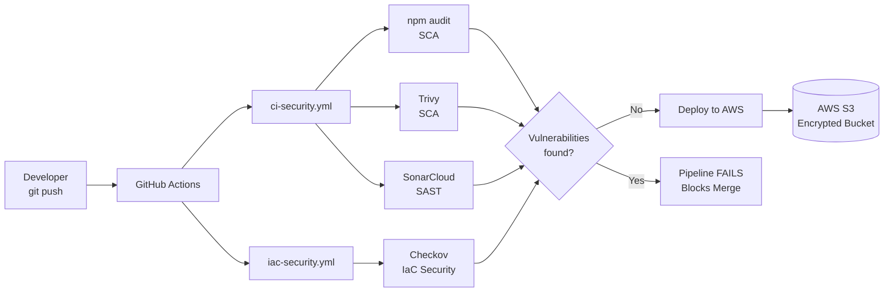

# DevSecOps Pipeline — Projeto de Portfólio

Pipeline CI/CD com segurança automatizada integrada. **Impede que código vulnerável chegue à cloud**, detetando problemas em cada fase do ciclo de vida do desenvolvimento.

---

## Fluxo do Pipeline



---

## Stack de Segurança

| Ferramenta | Tipo | O que deteta | Quando corre |
|-----------|------|-------------|-------------|
| **npm audit** | SCA | Pacotes com CVEs conhecidos | Todo push/PR |
| **Trivy** | SCA | CVEs em dependências e configs | Todo push/PR |
| **SonarCloud** | SAST | SQL Injection, hardcoded secrets | Todo push/PR |
| **Checkov** | IaC Security | Configurações AWS inseguras | Alterações em `/infra` |

---

## Antes e Depois das Correções

### Dependências (SCA)

| Pacote | Antes | Depois | CVE |
|--------|-------|--------|-----|
| `lodash` | 4.17.4 | **4.18.1** | CVE-2018-16487 (Prototype Pollution) |
| `express` | 4.16.0 | **4.22.2** | CVE-2024-29041 (Open Redirect) |

### Código Fonte (SAST)

| Vulnerabilidade | Antes | Depois |
|----------------|-------|--------|
| API Key hardcoded | `const API_KEY = "sk-test-12345abcdef"` | `process.env.API_KEY` |
| SQL Injection | `SELECT * FROM users WHERE email = '${email}'` | Input validado, sem concatenação |

### Infraestrutura (IaC Security)

| Regra Checkov | Antes | Depois |
|--------------|-------|--------|
| **CKV_AWS_2** — ACL pública | `acl = "public-read"` | Removida (usa default private) |
| **CKV_AWS_19** — Sem encriptação | Não configurado | `AES256` com bucket key |
| **CKV_AWS_20** — Sem public access block | Não existia | 4 flags `true` |
| **CKV_AWS_21** — Sem versionamento | `status = "Suspended"` | `status = "Enabled"` |

---

## Como Correr Localmente

### Pré-requisitos

- Node.js 20+
- Python 3.x + pip (para Checkov)
- Trivy (opcional, para SCA local)

### 1. Clone e instale

```bash
git clone https://github.com/01RodrigoHenriques/devsecops-pipeline.git
cd devsecops-pipeline/app
npm install
```

### 2. Configure as variáveis de ambiente

```bash
# Linux/macOS
export API_KEY="minha-chave-segura"
export API_SECRET="meu-segredo-seguro"

# Windows (PowerShell)
$env:API_KEY="minha-chave-segura"
$env:API_SECRET="meu-segredo-seguro"
```

### 3. Execute a API

```bash
npm start
# Servidor arranca em http://localhost:3000
```

### 4. Corra os security scans localmente

```bash
# npm audit (SCA)
cd app && npm audit --audit-level=high

# Trivy (SCA filesystem)
trivy fs --severity HIGH,CRITICAL --exit-code 1 .

# Checkov (IaC Security)
checkov -d infra --framework terraform --check CKV_AWS_2,CKV_AWS_19,CKV_AWS_20,CKV_AWS_21
```

---

## Configuração de Secrets no GitHub

Ir a **Settings > Secrets and variables > Actions** no repositório GitHub:

| Secret | Onde obter |
|--------|-----------|
| `SONAR_TOKEN` | https://sonarcloud.io > My Account > Security > Generate Token |
| `AWS_ACCESS_KEY_ID` | AWS IAM > Security Credentials |
| `AWS_SECRET_ACCESS_KEY` | AWS IAM > Security Credentials |

### SonarCloud — Configuração

1. Criar conta em https://sonarcloud.io
2. Importar o repositório GitHub
3. Copiar `organization` e `projectKey` do painel
4. Atualizar `sonar-project.properties`:
   ```properties
   sonar.organization=O_TEU_USERNAME
   sonar.projectKey=O_TEU_PROJECT_KEY
   ```

---

## Estrutura do Projeto

```
devsecops-pipeline/
├── .github/workflows/
│   ├── ci-security.yml          # SCA + SAST pipeline
│   └── iac-security.yml         # IaC security (Checkov)
├── app/
│   ├── package.json              # Dependências seguras
│   ├── src/
│   │   └── index.js              # Express API (corrigida)
│   └── .gitignore
├── infra/
│   ├── main.tf                   # Provider AWS
│   ├── s3.tf                     # S3 (corrigido)
│   ├── variables.tf              # Variáveis Terraform
│   └── outputs.tf                # Outputs
├── SECURITY_LOGS.md              # Relatório de auditoria de segurança
├── sonar-project.properties      # Config SonarCloud
└── README.md                     # Este ficheiro
```

---

## Resultados dos Security Scans

Ver [SECURITY_LOGS.md](./SECURITY_LOGS.md) para o relatório completo com logs,
explicação técnica e contexto de cada vulnerabilidade detetada.

---

## Licença

MIT
