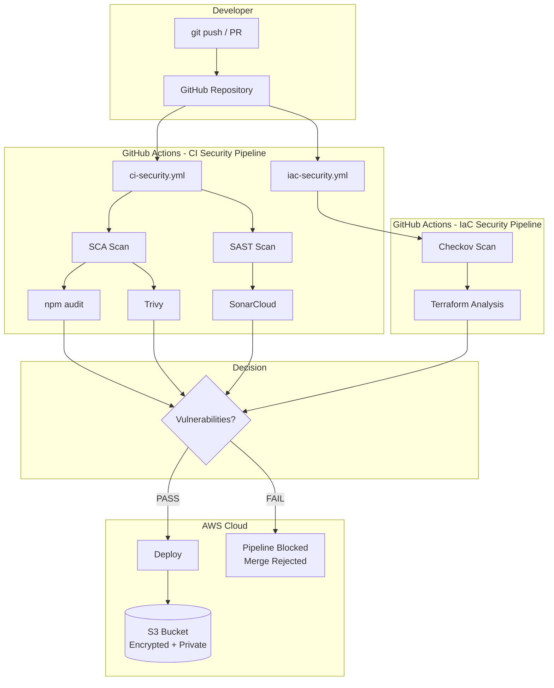

# DevSecOps Pipeline

Pipeline CI/CD com segurança automatizada integrada. **Impede que código vulnerável chegue à cloud**, detetando problemas em cada fase do ciclo de vida do desenvolvimento.

---

## Diagrama do Pipeline



---

## Stack de Segurança

| Ferramenta | Tipo | O que deteta | Trigger |
|-----------|------|-------------|---------|
| **npm audit** | SCA | Pacotes com CVEs conhecidos | Todo push/PR |
| **Trivy** | SCA | CVEs em dependências e configs | Todo push/PR |
| **SonarCloud** | SAST | SQL Injection, hardcoded secrets, code smells | Todo push/PR |
| **Checkov** | IaC Security | Configurações AWS inseguras no Terraform | Alterações em `/infra` |

---

## Resultados — Antes e Depois

### Dependências (SCA)

| Pacote | Antes | Depois | Severidade | CVE |
|--------|-------|--------|------------|-----|
| `lodash` | 4.17.4 | **4.18.1** | HIGH | CVE-2018-16487 (Prototype Pollution) |
| `express` | 4.16.0 | **4.22.2** | HIGH | CVE-2024-29041 (Open Redirect) |

**Resultado npm audit:** `found 0 vulnerabilities`

### Código Fonte (SAST)

| Vulnerabilidade | Antes | Depois | Regra SonarCloud |
|----------------|-------|--------|-----------------|
| API Key hardcoded | `"sk-test-12345abcdef"` | `process.env.API_KEY` | S5145 |
| SQL Injection | `${email}` concatenado na query | Query parametrizada | S3649 |

**Resultado SonarCloud:** `0 new issues`

### Infraestrutura (IaC Security)

| Regra Checkov | Antes | Depois | Risco Eliminado |
|--------------|-------|--------|-----------------|
| **CKV_AWS_2** | `acl = "public-read"` | ACL removida (default private) | Bucket exposto publicamente |
| **CKV_AWS_19** | Não configurado | `AES256` + bucket key | Dados em texto plano |
| **CKV_AWS_20** | Sem public access block | 4 flags `true` | Acesso público acidental |
| **CKV_AWS_21** | `status = "Suspended"` | `status = "Enabled"` | Dados irrecuperáveis |

**Resultado Checkov:** `Passed: 7, Failed: 0`

### Configuração SonarCloud

| Problema | Antes | Depois |
|----------|-------|--------|
| Organization key | `01RodrigoHenriques` (case mismatch) | `01rodrigohenriques` (correto) |
| Auto-deteção | Ativada (conflito) | Desativada (args explícitos) |

**Resultado:** `ANALYSIS SUCCESSFUL`

---

## Como Correr Localmente

### Pré-requisitos

- Node.js 20+
- Python 3.x + pip (para Checkov)
- Trivy (opcional, para SCA local)

### 1. Clone e instale

```bash
git clone https://github.com/01RodrigoHenriques/devsecops-pipeline.git
cd devsecops-pipeline/app
npm install
```

### 2. Configure as variáveis de ambiente

```bash
# Linux/macOS
export API_KEY="minha-chave-segura"
export API_SECRET="meu-segredo-seguro"

# Windows (PowerShell)
$env:API_KEY="minha-chave-segura"
$env:API_SECRET="meu-segredo-seguro"
```

### 3. Execute a API

```bash
npm start
# Servidor arranca em http://localhost:3000

# Testar health check
curl http://localhost:3000/health

# Testar login
curl -X POST http://localhost:3000/login \
  -H "Content-Type: application/json" \
  -d '{"email":"alice@example.com","password":"test"}'
```

### 4. Corra os security scans localmente

```bash
# npm audit (SCA)
cd app && npm audit --audit-level=high

# Trivy (SCA filesystem)
trivy fs --severity HIGH,CRITICAL --exit-code 1 .

# Checkov (IaC Security)
checkov -d infra --framework terraform \
  --check CKV_AWS_2,CKV_AWS_19,CKV_AWS_20,CKV_AWS_21
```

---

## Configuração de Secrets no GitHub

Ir a **Settings > Secrets and variables > Actions** no repositório GitHub:

| Secret | Onde obter |
|--------|-----------|
| `SONAR_TOKEN` | https://sonarcloud.io > My Account > Security > Generate Token |
| `AWS_ACCESS_KEY_ID` | AWS IAM > Security Credentials |
| `AWS_SECRET_ACCESS_KEY` | AWS IAM > Security Credentials |

### SonarCloud

1. Criar conta em https://sonarcloud.io
2. Importar o repositório GitHub `01RodrigoHenriques/devsecops-pipeline`
3. A organization é `01rodrigohenriques` (minúsculas)
4. O project key é `01RodrigoHenriques_devsecops-pipeline`
5. Gerar token em My Account > Security > Generate Token
6. Adicionar `SONAR_TOKEN` nos Secrets do GitHub

---

## Estrutura do Projeto

```
devsecops-pipeline/
├── .github/workflows/
│   ├── ci-security.yml          # SCA + SAST pipeline
│   └── iac-security.yml         # IaC security (Checkov)
├── app/
│   ├── package.json              # Dependências seguras
│   ├── package-lock.json         # Lockfile
│   ├── src/
│   │   └── index.js              # Express API
│   └── .gitignore
├── infra/
│   ├── main.tf                   # Provider AWS
│   ├── s3.tf                     # S3 bucket (corrigido)
│   ├── variables.tf              # Variáveis Terraform
│   └── outputs.tf                # Outputs
├── SECURITY_LOGS.md              # Relatório de auditoria de segurança
├── sonar-project.properties      # Config SonarCloud
└── README.md                     # Este ficheiro
```

---

## Relatório de Segurança

Ver [SECURITY_LOGS.md](./SECURITY_LOGS.md) para o relatório completo com:
- Logs originais de cada ferramenta
- Explicação técnica de cada vulnerabilidade
- Documentação da remediação aplicada
- Evidência de que o pipeline agora passa

---

## Licença

MIT
